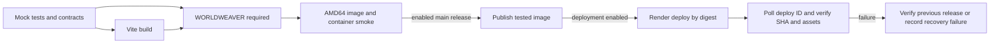

# Release and operations plan

The production unit is an image-backed Render web service. React and FastAPI share one origin. The Docker Hub digest identifies the executable artifact; its packaged full Git SHA identifies the tested sources.

The existing Windows job covers PowerShell startup, pytest, frontend tests, schema checks and generated types with transport isolation. The aggregate job evaluates both prerequisites even after failures. Container, publication and deployment use ordinary success dependencies. PRs can build and smoke the image without registry or Render secrets. Hosted Stage 6 execution and branch protection must be verified separately.

Release jobs serialize publication and deployment and check the current main SHA. Use a single deployment controller and restrict the GitHub production environment to main. Record the previous healthy release and refuse an overlapping deploy. A single POST starts the new deployment. The controller checks the Render-resolved image digest and the running application's exact SHA. On failure, recovery is attempted only while the controller's deploy remains latest. A recovered release still fails its original job. An ambiguous write or an external concurrent operation requires inspection of Render events before another release.

Protected paid generation is deferred pending hosting permission, durable spending controls and owner authorization. Keep provider credentials in the local server environment. Browser IndexedDB and portable exports remain the only creative project persistence. Native visual acceptance, actual registry publication, service setup and the deliberate failure campaign are separate evidence gates.

[Owner setup](DEPLOYMENT_GUIDE.md) · [Evidence campaign](DEPLOYMENT_EVIDENCE_PLAN.md) · [Phase 6A results](PHASE_6A_REPORT.md)

## Sustainability

Compare calls, retries, reported tokens, geometry time, build time and artifact sizes for the same fixture across revisions. Reuse accepted intermediate stages until their inputs change. Use local deterministic geography and validators, mock ordinary CI, and recheck affected domains on edit. Keep a full check at approval/release. These are measurable engineering choices. Energy or carbon impact requires separate measurement.
