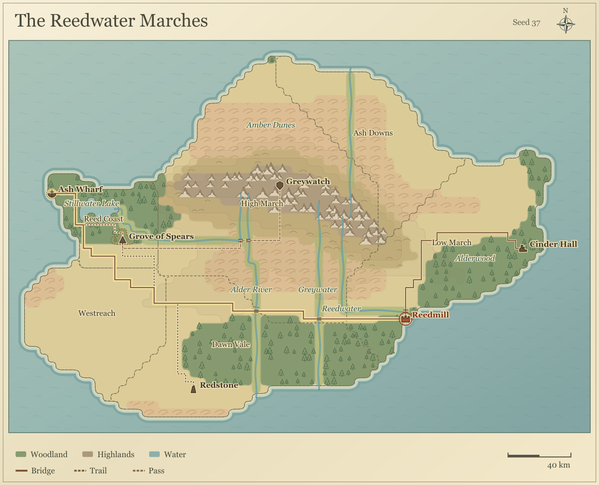

# World Atlas 사용 및 생성 규약

승인한 시나리오를 열고 **World Atlas**에서 장소 목록과 지리 요구 사항을 먼저 확인한다. **Generate continent**는 현재 브라우저에서 실행한다. 생성, 이동, 경로 재계산, 재검증의 모델 요청 예산은 각각 0회다. 창을 닫기 전에 작업본 저장 오류가 없는지 확인한다.

위 그림은 72×48셀, 장소 6곳과 경로 5개의 설계 데이터를 제품의 SVG 내보내기로 그린 뒤 QtSVG로 래스터화한 결과다. 지도 화면에서는 각 장소와 경로를 직접 선택할 수 있다.

## 입력과 재현

승인된 내러티브와 현재 시나리오 버전, 장소 ID, 장소 유형, 구조화된 지리 요구, 장면·퀘스트·상태 조건의 장소 참조를 사용한다. 물 부족 등의 이야기 문장은 소유자가 관계를 명시할 근거로 읽을 수 있다. 문장 자체로 하천이나 국가를 생성하지 않는다. 생성기는 필수 이동을 선언한 시나리오 연결의 두 장면에서 이동 끝점을 읽는다. 장소가 빠진 필수 이동은 승인을 차단한다. 일반 서사 연결은 여행 경로를 만들지 않는다.

`atlas-1`의 시드는 0–4,294,967,295 사이 정수다. 같은 입력·시드·설정·생성기 버전은 같은 의미 데이터를 만든다. 입력 배열의 순서와 실행 시각에 의존하지 않는다. 저장 트랜잭션과 검증 기록에는 별도 ID를 부여한다. 기존 장소와 잠금, 소유자 요구 사항도 재생성의 입력이다.

기본값은 표준 대륙, 시드 42, 4 km/셀, 육지 목표 56%, 온대 기후다. 소형은 48×32, 표준은 72×48이다. 육지 목표는 35–75%, 축척은 0.1–100 km/셀이다. 기복, 정착지·도로·영토 밀도는 각각 4단계다. 섬 지형과 건조·한랭 기후를 선택할 수 있다. 한 번에 입력 장소 96개, 요구 사항 128개까지 처리한다. 단계 완료 시 진행 상황을 표시하며 단계 사이에서 취소할 수 있다.

## 지형과 수문

1. 좌표에 시드를 섞은 연속 잡음을 방사형 분포에 합성한다. 현재 육지와 변을 공유하는 후보 중 점수가 높은 셀부터 목표 면적까지 성장시킨다. 섬 프리셋은 서로 다른 두 시작점과 해협을 사용한다.
2. 해안까지의 격자 거리, 잡음 능선과 기복을 합성하여 정수 미터 고도를 정한다. 고도·위도와 기후·수분 분포를 이용해 평야, 구릉, 산악, 산림, 사막, 설원, 계곡을 구분한다. 지역에 특수 생물군계를 지정할 때 판타지 설정의 근거를 함께 저장한다.
3. 내륙 함몰지를 범람시켜 이어진 호수와 수면을 만든다. 외해와 끊긴 물도 호수로 분류한다. 하천은 변을 공유하는 더 낮은 셀로만 흐른다. 바다·호수 또는 기록된 폐쇄 분지에서 끝난다. 지도 축척에서 서로 다른 유역이 보이도록 주요 하구를 띄워 선택한다. 평지에서 흐름을 꾸며 이어 붙이지 않는다. 계절별 강수량이나 유량은 계산하지 않는다.
4. 여러 지점에서 동시에 육지로 영역을 넓혀 지리적 지역을 만든다. 영토는 그 지역들의 집합이다. 한 영토에 여러 세력의 영향력을 기록할 수 있다. 초기에는 세력 소유권을 비워 둔다.

`tiles[y][x]`의 원점은 북서쪽, 오른쪽은 동쪽, 아래는 남쪽이다. 각 셀의 지표는 한 종류이며 인접은 변 4개를 기준으로 한다. 지역과 숲·저수지 면은 셀 집합으로 저장하고, 외곽선은 표시할 때 계산한다. 공유 모서리와 구멍을 처리하므로 원본과 별도로 편집할 대륙 다각형이 생기지 않는다. 강, 산줄기, 도로는 의미가 서로 다른 피처다.

## 배치, 장소의 층, 이동

시나리오가 선언한 장소 ID는 그대로 유지한다. 지도상 배치와 지도용 표기는 `world.placements[].locationId`로 연결한다. 기존 지도 소유 장소와 추가한 마을은 `world.locations`에 있다. 숲·저수지는 면과 대표 이동점을 가질 수 있다. `level`이 다르면 같은 평면 좌표에 지하도시와 지상 유적을 놓을 수 있다. 같은 층의 우연한 중첩은 검사 대상이다.

| 관계 | 만족 조건 |
|---|---|
| near | 대표점의 가로·세로 셀 거리 합이 4 이하 |
| river | 실제 자연 하천의 강변 셀에 배치. 특정 하천을 지정하면 해당 ID를 사용 |
| beneath | 같은 x, y에서 지하 장소의 층 번호가 상대보다 낮음 |
| separates | 제3 장소가 두 대표점을 잇는 최단 격자 경로에 있고 두 방향이 반대쪽을 향함 |
| inside / outside | 대표점이 지정한 지역·영토 또는 장소 면에 소속되거나 그 밖에 있음 |
| travel | 두 장소를 잇는 검증된 이동 경로가 있음. 같은 장소에서의 장면 전환에는 이동 불필요 |
| canal / aqueduct | 지정한 양 끝점을 잇는 해당 종류의 인공 수로가 있음 |

시나리오의 명시적 요구는 강제 조건이다. 소유자가 추가한 조건에는 강제 또는 선호를 지정한다. 지리 계획에서 출처와 강도를 확인하고 수정할 수 있다. 배치는 잠긴 좌표를 유지하고 강제 조건을 먼저 평가한다. 제한된 탐색에서 충족하지 못한 조건에는 원인과 대상 ID를 남긴다. 불가능 진단은 해당 배치에서의 실패를 의미하며 모든 배치의 수학적 불가능성 증명은 아니다.

이동 경로는 지형과 고도차를 비용에 반영하는 Dijkstra 탐색으로 계산한다. 강 횡단과 산악 구간, 교량·산길, 터널, 항구 간 해로, 인공 수로의 역할을 구분한다. 섬 사이에는 해로의 양 끝에 항구가 필요하다. 수로·수로교만으로 필수 여행이 성립하지 않는다. 경로의 실제 셀 구간 길이에 축척을 곱한다. 층 하나의 수직 이동은 이 설계 모델에서 50 m다. 경로 거리 비교 허용 오차는 0.0005 km다. 이동 시간은 추정하지 않는다.

## 편집, 검증, 복구

- 장소·지역·영토·경로를 지도나 **Atlas index**에서 선택한다. 장소를 옮기면 면과 영향받는 경로를 갱신하고 조건을 다시 평가한다. 잠금, 경로 재계산, 잠기지 않은 장소만 다시 배치하기, 현재 편집 세션의 12단계 되돌리기를 지원한다.
- 검사는 원본 승인·버전, 장소 커버리지, 참조·ID, 고도·수면·강의 흐름, 지역 분할, 좌표·층·면, 이동 구간과 거리, 필수 여정, 강제 조건을 포함한다. 대상 버튼으로 위치나 경로를 찾는다. 선호가 깨지면 경고를 유지한다. 지명·정치 경계·상징성이 이야기와 어울리는지는 소유자가 검토한다.
- 화면에 표시된 **Working proposal**은 별도 IndexedDB의 편집본이다. 차단 오류가 남아도 같은 주소에서 다시 열 수 있다. 조건이나 좌표를 수정한 뒤 **Recalculate routes → Revalidate world**를 사용한다. **Discard world proposal**을 선택하면 저장된 프로젝트로 돌아간다.
- 차단 오류가 없을 때 **Accept world draft**로 프로젝트에 초안을 저장하거나 **Approve world**로 승인한다. 승인본 편집은 다시 작업본에서 시작한다. 다른 탭의 변경과 오래된 원본을 검사한다. **Reconcile with approved scenario**는 기존 배치를 보존하고 현재 요구와 누락 장소를 반영한 검토본을 만든다.
- **Show location on atlas**로 장면에서 장소를 열고, 장소 검사기에서 연결된 장면이나 퀘스트로 돌아간다. **Scenario journeys**는 실제 이동이 요구된 연결의 경로 구간을 강조한다.
- **Export saved project JSON**으로 채택한 전체 설계를 백업한다. **Export atlas Markdown**은 읽기용 지리 설계서를, **Export SVG**는 범례·북쪽·축척을 포함하는 전체 지도를 내보낸다. 표시 레이어와 시점은 프로젝트별 로컬 보기 설정이다. 다른 주소나 프로필에서 작업하려면 JSON을 가져오고 시나리오·지도를 다시 검토한다.

[검증 캠페인과 개별 시드](ATLAS_CAMPAIGN.md) · [Phase 3 검토 보고서](PHASE_3_REPORT.md)
